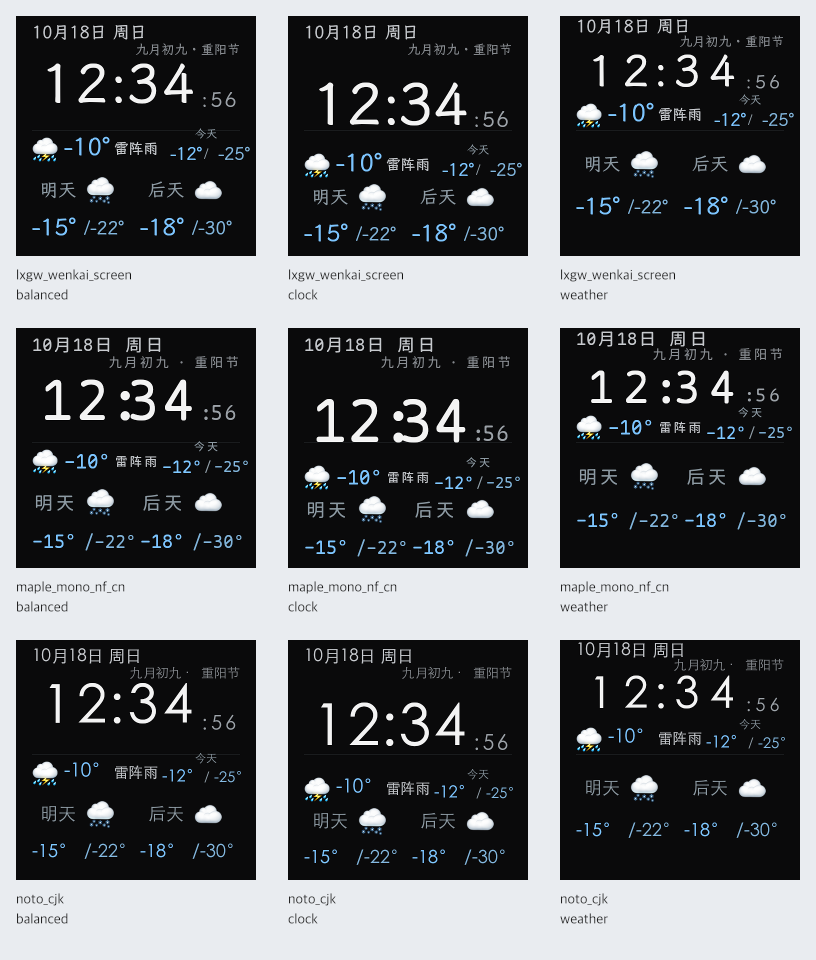

# 决策记录: 桌面屏正确性与刷新修复

状态: implemented

## 问题

[体验与性能审查](../../proposed/feature/2026-11-12-桌面屏体验与性能审查.md)发现配网保存、连接恢复、天气时效、布局边界、命令确认和无变化刷新存在可独立修复的问题。用户要求分派 sub agent 实施值得处理的部分，完成后提交推送并记录文档。

## 决策

本轮实施行为明确且可以独立验证的修复。三名 sub agent 分别处理固件、服务端传输与刷新、天气与小屏；主代理集成控制台反馈、现行规格、文档记录和最终验证。保留现有渲染架构、配色、字体选项、布局预设和依赖版本。

### 配网与画面恢复

- 同一 SSID 的密码留空保留已保存的密码。更换 SSID 后留空表示开放网络；明确勾选清除密码会优先清空。密码原始空格保持不变，表单说明与保存行为一致。
- WiFi 断开后停止 LAN 配置服务并保留配置引用；连接恢复后按当前 IP 重新启动。已运行且 IP 未变的配置服务直接返回，避免每轮重新扫描。
- 本地整屏状态提示和 HTTP 拉帧失败直接使已持有帧编号归零，下次请求完整帧。原有独立错误画面标记与延迟清理函数被删除。
- 串口帧体或信封校验失败后回报 `frame_id=0`。流式解码可能已经写入部分像素，完整帧用于恢复所有像素。
- Button2 显式使用 `kButtonDoubleClickMs`，当前为 250 ms。

### 命令确认与刷新

串口命令复用现有编号与 `COMMAND_ACK`。未确认命令每隔一秒重试，最多发送三次；匹配 ACK 停止重试。新命令替换待确认命令，同设备再次 HELLO 后恢复尚未确认命令的发送次数，更换设备后重置确认状态。

首页仅调整亮度只排队设备命令。设置页和亮度详情仍更新可见数值，使用局部帧。静态设置和详情页停止按秒渲染，输入、配置、可见状态变化和未结束动画仍触发刷新。

串口经过两秒没有发送帧后，用零矩形差分保活。`frame_id` 与 `base_frame_id` 都等于设备当前帧编号，ACK 保持该编号，画面不变。初始连接继续全屏同步。HTTP 继续使用长轮询和 204，保留命令编号响应头。

缺失诊断字段保持 `undefined`，真实零值正常显示。控制台亮度提示改为操作说明，全局同步状态明确指向服务；预览标为「服务预览」。这些提示不承诺设备已应用命令。

### 天气与小屏

天气按 Asia/Shanghai 的当前小时和实际日期选取。超过一小时的快照停止用于首页，一小时对应两个默认刷新周期。缺少当前小时数据只隐藏当前天气，有效日期预报继续显示；缺失日期不会改变后续日期标签和列位置。状态 API 保留表示缓存存在的 `hasData`，新增 `stale` 标记，控制台明确显示过期。

节日农历使用独立一行，日期和温度只在超出各自区域宽度后缩小字号。今日高低温预留负号与数字宽度。新增可选的 `textFit` 样式，使用现有文字测量和绘制过程。主题详情说明短按应用，Renderer 详情展示协议、像素格式、尺寸和帧类型。

节日标题可能占用屏幕顶部，因此首页顶部差分区域从第 0 行开始。三个首页差分区域连续覆盖 240×240 画布，跨午夜也能更新标题全部像素。

下图使用固定测试日期、构造的负温度天气和三种字体选项，展示三个布局。Noto CJK 在本机使用回退字体。

### 文档与复杂度审查

现行协议与行为同步到 [remote-rendering-http-frame-design.md](../../../../docs/remote-rendering-http-frame-design.md)。AGENTS.md 和中英文 README 修正 TFT 配置入口，并明确 Mac 串口配置需匹配实际设备节点。

本轮复用了命令编号、串口检查定时器、帧 ACK、设备注册表和光栅化过程。保活只增加发送时间记录；亮度可见性判断由实际刷新入口复用。新增的 64 行 Host Arduino 测试替身只提供字节队列、计时和空日志/看门狗，生产构建继续使用真实 Arduino 实现。

省略坏帧归零会保留已经写入的错误像素，省略天气日期匹配会继续错标预报，省略顶部差分范围修正会在跨节日后留下旧标题；相应回归测试保留。新增通用调度、配置或布局框架没有必要。

### Deviations

初始实施范围未明确包含静态页的串口保活。移除周期渲染后，设备仍需要下行数据维持链路判断，因此增加已有 SDD1 格式的空差分帧，并用真实固件消费器验证兼容性。

排版修复上移节日标题后，独立审查发现旧顶部差分范围不完整。新增跨午夜测试先复现失败，再扩大顶部差分范围。测试覆盖三种字体、三种布局以及进入和离开节日两个方向。

本轮只修正亮度和预览反馈的表达。设备已应用状态尚未暴露为控制台独立字段，命令 ACK 的处理当前用于串口重试控制。

## 曾考虑的替代方案

- 一次实施全部审查建议：视觉偏好和新功能行为尚未确定，按键采样、长按接收与主循环时序还需要实机验证。
- 只改文案：无法解决配网保存、天气数据和传输确认的实际问题。
- 保留旧帧编号并等待差分修复：失败帧写过的区域可能不在后续差分中，无法保证画面恢复。
- 用 HELLO 保活静态页：HELLO 会重新建立链路并触发全屏同步；同编号空差分可以保持当前画面。
- 新增通用任务、布局或调度框架：已有协议、状态与渲染流程足以完成这些修复。

## 影响

### 验证结果

- `cd remote-render && npm test`：19 个文件、155 项测试成功。
- `cd remote-render && npm run typecheck`：成功。
- `cd remote-render && npm run build`：服务端与控制台构建成功。
- `~/.platformio/penv/bin/pio test -e host`：47 项成功。
- `~/.platformio/penv/bin/pio run -e esp12e`：成功；静态 RAM 40,648 / 81,920 B，Flash 507,520 / 1,044,464 B。
- 新增密码保存、天气跨小时跨日与过期、命令重试及重连、静态页刷新、亮度局部更新、诊断零值、负温度和长日期边界测试。
- Host 回归直接编译 `SerialFrameLink` 和 `FrameStreamConsumer`，验证内层 CRC 和信封 CRC 失败后的全屏恢复，以及同编号空差分的像素与 ACK 行为。
- 跨午夜差分回归修复前失败，修复后成功；逐像素检查目标画面的变化全部处于输出矩形中。
- 九组边界预览已检查文字排列，包含天气布局「今天」标签与秒数字的纵向间距。
- 全量差异、相对链接与文字规则检查成功。

固件静态 RAM 比审查基线增加 248 B，Flash 增加 504 B。构建仍有 TFT_eSPI 的触摸引脚未配置与 SPIFFS 弃用提示，依赖版本保持原样。

### 部署与剩余边界

本轮没有修改生产配置、重启服务或烧录设备。运行服务与源码的接口差异、实际串口节点配置仍需部署阶段处理。HTTP/WiFi 恢复、物理按键延迟、长按接收时序与面板小字效果仍需实机验证。真实 Noto 字形需安装对应字体后复核。

`COMMAND_ACK` 只包含编号，服务按最近 HELLO 的设备归属处理；跨设备且编号相同的迟到 ACK 无法区分。本轮保持该协议边界。

一小时天气有效期会使长期网络故障期间的首页暂时隐藏天气。夜间亮度、秒数开关、新内容页和完整视觉改版继续保留在审查提案中。
