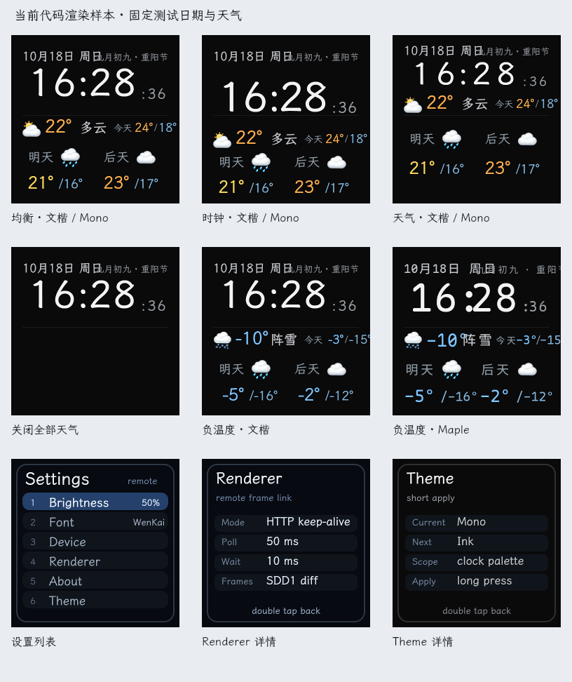

# 决策记录: 桌面屏体验与性能审查

状态: proposed

## 问题

审查日期：2026-11-12。源码基线：`cae6258`。本报告覆盖 ESP8266 固件、小屏页面、远程渲染服务、Web 控制台和本机运行状态。

下文记录审查基线的行为与测量结果。配网保存、连接恢复、天气时效、排版边界、串口命令确认和无变化刷新已完成一轮修复，见[实施记录](../../implemented/bug-fix/2026-11-12-桌面屏正确性与刷新修复.md)。视觉原型、新功能和实机时序等剩余建议继续保留为提案。

项目有明确的改进空间。建议先修复信息失效、连接恢复和操作反馈，再调整小屏排版，随后增加常开使用需要的功能。现有瘦客户端、差分传输和服务端渲染架构适合继续使用，本次测量没有发现需要整体重写的性能压力。

### 当前已经具备的能力

- 小屏有中文时钟、日期、农历、天气，以及亮度、字体、主题和诊断设置。源码提供三种首页布局、三种字体选项和五种主题。
- 当前源码中的控制台支持首页内容开关、外观配置、亮度、手势模拟、草稿预览、配置自动同步和历史版本。配置已有原子保存和 ETag 冲突处理。
- 帧传输已有局部差分、RLE、全屏帧惰性编码、最近八帧差分补发、HTTP Keep-Alive 和串口停等发送。固件已有流式解码、CRC 查表、分批写屏和 40 MHz SPI。
- 歌词、更多内容页面、天气位置与单位仍有明确的阶段边界。继续实施应沿用[内容提案](2026-08-23-桌面内容页面与同步歌词.md)和[配置模型提案](../architecture/2026-08-23-Web控制台与配置模型.md)。

### 现场运行状态与源码有差异

只读访问本机 `127.0.0.1:18080` 得到以下结果：

| 项目 | 本次观察 | 影响 |
| --- | --- | --- |
| 服务和设备 | `/api/v1/health` 正常；`desk-01` 最近通信间隔为 0 秒，首页使用 Mono、文楷、25% 亮度 | 服务与设备仍在通信 |
| 串口 | launchd 配置为 `/dev/cu.wchusbserial3110`；实际节点为 `/dev/cu.wchusbserial3120` | 日志持续报端口打开失败；结合设备在线状态，推断当前使用 WiFi 回退 |
| 控制台 API | `/api/v1/catalog`、`/api/v1/devices/desk-01/config` 返回 404；状态响应缺少当前源码中的 `config` 字段 | 运行进程提供的接口与当前源码不同，具体构建来源尚未定位 |
| 日志 | `~/Library/Logs/sdd-remote-render.log` 约 91 MB，末尾反复出现相同端口错误 | 先修正连接配置，再限制重复日志频率并明确保留周期 |

因此，源码中已完成的功能不能直接作为当前设备部署版本的说明。后续发布应显示服务构建版本、固件版本和实际传输方式，并验证上述接口。此次未重启服务、修改 launchd 配置或烧录固件。

## 提案

### 建议优先级

这里的 P1 表示建议下一轮先处理，P2 表示随后改进；优先级同时考虑使用影响和修改范围。

| 优先级 | 工作项 | 预期收益 | 确认程度 |
| --- | --- | --- | --- |
| P1 | 核对运行版本、修正串口设备路径 | 恢复预期部署，减少重复错误 | 现场已确认 |
| P1 | 修复配网页密码保存和 WiFi 恢复流程 | 修改配置、断网恢复后可以继续使用 | 代码已确认；恢复画面需实机验证 |
| P1 | 天气按实际时间筛选并标记过期 | 旧预报不会继续使用当前日期标签 | 独立复现 |
| P1 | 修复长日期、节日和负温度布局 | 常见边界内容可以完整阅读 | 字宽测量与图片复现 |
| P1 | 串口命令确认与控制台反馈 | 用户能分辨服务已接收和设备已应用 | 假串口复现及代码确认 |
| P2 | 按键采样、长按期间串口读取、坏帧恢复 | 减少漏按、超时和残留画面 | 代码路径确认，实机影响待测 |
| P2 | 隐藏秒数、关闭动画、减少无变化渲染 | 改善常开观感，减少计算和传输 | 代码与本地计时确认 |
| P2 | 内容开关后的重排、设置提示和真实诊断 | 页面更易读，操作含义一致 | 部分为审美选择，先比较原型 |

### 小屏 UI：先修复阅读问题，再统一风格

下图由当前渲染器直接生成。输入使用固定测试日期 `2026-10-18` 和构造天气，包含三种布局、关闭天气、负温度及设置页面。图中的天气用于检查排版。

当前深色底、突出时间的结构可以保留。主要问题集中在固定坐标与真实文字长度之间的冲突，以及设置页和首页的表达差异。

**长日期与农历节日重叠。** 公历和农历分别使用固定区域，文字绘制没有裁剪或省略规则。`10月18日 周日` 与 `九月初九 · 重阳节` 的字宽区域在文楷下相交约 11.41 px，Maple 下约 30.60 px。建议先定义同一行可用宽度，长节日文案使用第二行或有规则的简写；仅缩小所有文字会降低日常可读性。定位：`remote-render/src/renderer/pages/home.tsx:20`、`:25`，`remote-render/src/renderer/rendering/rasterizer.ts:122`。

**负温度超出屏幕。** 今日低温从 x=210 开始，可用画布宽度仅 30 px。17 px 的 `-15°` 在文楷下约 31.79 px，Maple 下约 40.80 px；25 px Maple 的当前温度 `-10°` 宽 60 px，与后方天气描述相交约 10 px。建议给符号、数字和单位分配明确空间，按实际字宽排列天气摘要，并检查高低温组合。定位：`remote-render/src/renderer/pages/home.tsx:77`、`:92`。

**内容开关需要对应的布局。** 关闭天气后，时钟仍保持原坐标，下半屏出现较大空白。可以只覆盖几个常见组合，例如时钟单独显示、时钟加当前天气、完整天气；无需增加任意拖拽布局编辑器。依据：`remote-render/src/renderer/pages/home.tsx:19`、`:51`。

**设置页需要一致的语言和反馈。** 首页与控制台使用中文，设置页仍有较多英文；主题详情同时显示 `short apply` 和 `Apply / long press`，短按实际上已立即改变主题。建议优先修正错误说明，再比较中文设置页样例。常用操作可以提示「短按选择 · 长按进入 · 双击返回」。React、Yoga 等实现信息适合保留在诊断详情中。依据：`remote-render/src/renderer/services/view-model.ts:166`、`remote-render/src/ui-state.ts:154`。

**颜色与图标属于后续审美选择。** 现有主题主要改变首页文字，天气仍使用固定温度颜色和彩色图标，设置页主要使用固定蓝色。可以先给出三组低成本原型，再确定完整改版方向：

| 原型方向 | 主要调整 | 需要比较的取舍 |
| --- | --- | --- |
| 日常时钟 | 放大时分，日期分行，天气只保留当前值，秒数可关闭 | 阅读距离与信息数量 |
| 天气概览 | 时钟缩小，当前天气与未来两天按统一列宽排列 | 负温度完整显示与时间字号 |
| 单色静态 | 统一低彩度图标和文字，关闭翻页，减少装饰线 | 视觉安静程度与天气识别速度 |

上述方向尚未实现。此次图片展示当前代码，不能作为改版原型。正式改版前应按项目约定先比较原型。

控制台 PNG 使用转换前 RGBA；设备像素还经过默认饱和度 1.35、gamma 1.15 的补偿及 RGB565 量化。截图足以检查布局，暗部、颜色和细字仍需实机确认。后续可增加设备编码后的预览，但它仍无法还原真实面板表现。依据：`remote-render/src/renderer/rendering/panel-profile.ts:1`、`remote-render/src/renderer/rendering/canvas-frame.ts:14`。

### 功能与反馈：先保证数据和设备状态可信

**天气时效。** `buildWeatherView()` 总是取 `hours[0]`，日期直接按数组索引标为今天、明天、后天。获取失败后继续保留快照，显示层没有使用 `fetchedAtMs` 判断过期。注入七天前快照仍能生成上述日期标签。建议按当前时间选择小时和日期，并定义缓存过期后的显示规则。具体期限需结合刷新周期确定；当前默认刷新间隔为 30 分钟，尚无过期阈值。定位：`remote-render/src/renderer/services/weather.ts:101`、`:198`、`:216`。

**设备应用确认。** 亮度接口成功只说明服务端已排队命令，控制台随即显示「设备已同步」。设备离线也可走到这个状态。串口端发送前就推进 `lastCommandSent`，没有处理 `COMMAND_ACK`；同一传输实例重连后也保留已发送编号。假串口复现中，未确认的亮度命令在重连后仍未重发。建议复用已有命令 ID 和 ACK，分别记录发送与确认，并设置有限重试；界面区分「待设备应用」与「设备已应用」。定位：`remote-render/src/serial/serial-transport.ts:149`、`:238`、`:298`，`remote-render/console/src/App.tsx:367`、`:1093`。

**预览与版本名称。** 预览来自服务端渲染，「实时」标签主要取决于草稿状态，无法说明设备已经显示该帧。建议在旁边显示最近通信时间。当前「发布」保存历史版本，配置早已自动生效，可改用「保存版本」或明确说明其作用。现有配置模型和历史机制可以继续保留。定位：`remote-render/console/src/App.tsx:1273`；[版本历史决策](../../implemented/architecture/2026-08-23-控制台实时同步与版本历史.md)。

**诊断信息。** 小屏 Renderer 详情固定写 `HTTP keep-alive / 50 ms / 10 ms`；真实碎片率为 0% 又会显示 `waiting`。这些应由实际链路和是否已上报决定。字体目录也可以显示字体可用状态；本机 Noto CJK 未注册，选中后会使用回退字体。定位：`remote-render/src/renderer/services/view-model.ts:133`、`:144`，`remote-render/src/renderer/services/font-registry.ts:32`。

### 固件可靠性与按键手感

**配网页保存会清空密码。** 密码框默认留空，保存处理无条件覆盖已有密码，并重启设备。用户只改服务地址或设备 ID，也会清空已保存的 WiFi 密码。`psk.trim()` 还会改变包含前后空格的密码。建议同一 SSID 留空保持旧密码，清除密码使用明确操作；更换 SSID 需要单独定义提示，并保留密码原始字节。定位：`src/app/WifiPortalPage.cpp:185`、`src/Net.cpp:250`、`:278`。

**WiFi 恢复缺少完整处理。** 断网提示直接覆盖整屏，没有使远程帧编号失效；恢复后接收局部帧或 204，可能留下离线文字。网络断开还会停止 LAN 配置服务，自动重连路径没有重新启动它。建议连接状态变化后恢复配置服务，并在本地状态画面覆盖屏幕后强制一次全屏同步。代码缺口已确认，残留画面的范围需实机验证。定位：`src/main.cpp:508`、`src/Net.cpp:403`。

**按键采样会受到同步 I/O 影响。** 按键主要在主循环开始时采样，整帧读取、HTTP 请求和部分重连等待期间没有执行同样的采样。短按全部发生在阻塞区间内，就有漏检条件。HTTP 拉帧等待参数为 80 ms，错误超时和输入 POST 超时为 5 秒；后台 WiFi 连接仍可能同步等待 12 秒。应先测按键到可见变化的延迟，再在读流批次间采样并排队事件，帧处理结束后发送，防止读取期间递归发起网络操作。定位：`src/remote/FrameStreamConsumer.cpp:19`、`src/Net.cpp:337`、`src/main.cpp:430`。

双击窗口还有一个小范围修正：`AppConfig.h` 声明 250 ms，`Input.cpp::begin()` 未调用 `setDoubleClickTime()`，实际使用 Button2 1.6.5 默认的 300 ms。先使配置生效，再测单双击边界。定位：`src/AppConfig.h:27`、`src/Input.cpp:65`。

**长按暂停串口读取有溢出条件。** 当前按住期间停止串口处理，RX 缓冲为 4,096 B。停等协议限制一帧在途，但单帧可超过缓冲；921600、8N1 下约 44 ms 即可传入 4,096 B。建议保持接收处理，把本地进度反馈安排在读取批次之间，或在双方约定的帧边界暂停下一帧。具体丢包与超时情况仍需实机复现。定位：`src/main.cpp:436`、`remote-render/src/serial/serial-transport.ts:261`。

**坏帧恢复需要全屏同步。** 流式解码会在最终 CRC 校验前写入部分像素；校验失败后继续保留旧帧编号，后续差分未必覆盖已经写坏的区域。建议已开始写屏且帧失败后请求全屏同步，正常成功路径继续使用差分。用故障注入比较最终画面，验证恢复是否完整。定位：`src/remote/FrameStreamConsumer.cpp:120`、`src/remote/SerialFrameLink.cpp:133`、`remote-render/src/state.ts:504`。

### 性能测量与改进顺序

本地使用 Node v22.23.0、macOS arm64 和当前构建产物，注入固定 12 小时及 3 日天气，用模拟时间推进 30 秒、每 25 ms 查询一次，所有样本排除首秒。耗时统计仅包含产生帧的 `getFrame()` 调用，覆盖本地渲染、差分与编码；无帧查询未计入，不含网络、USB、设备解码和 TFT 写入。模拟帧数量无法用作实机帧率。

| 布局 | 计算耗时 P50 | P95 | 帧大小 P50 | P95 | 编码流量 | 首张整屏 |
| --- | ---: | ---: | ---: | ---: | ---: | ---: |
| 均衡 | 1.79 ms | 3.48 ms | 792 B | 1,071 B | 7.10 KB/s | 23.78 KB |
| 时钟 | 1.77 ms | 4.27 ms | 927 B | 1,268 B | 8.23 KB/s | 24.40 KB |
| 天气 | 1.38 ms | 2.85 ms | 703 B | 906 B | 6.17 KB/s | 22.69 KB |
| 设置静止 | 1.19 ms | 2.44 ms | 32 B | 32 B | 约 33 B/s | — |

统计窗口为 `[1s, 30s]`，包含两端采样。三个首页样本各产生 256 帧 / 29 秒；设置静止样本的 30 帧都没有矩形，仍经历完整渲染再得到空帧。设置样本的 960 B 除以 29 秒约为 33 B/s，长期稳定值约为 32 B/s。KB 使用十进制单位。这些数据用于比较本机实现，不能代表其他宿主机或生产服务的性能。

串口的理论有效上限为 `921600 / 10 = 92,160 B/s`。23.78 KB 整屏仅传输就约需 258 ms；未压缩的 `240 × 240 × 2 = 115,200 B` 整屏约需 1.25 秒。20 fps 的 50 ms 周期最多容纳 4,608 B，还需扣除协议与设备处理开销。视觉改版应以局部变化为主，照片、大面积渐变和全屏动画需要单独测量压缩与传输成本。

优先做以下小范围优化：

1. **亮度变化减少整屏重发。** 固定时刻、无天气首页修改亮度，前后 RGBA 完全相同，却产生 10,179 B 的整屏帧。首页可只下发命令，亮度详情再更新数值。定位：`remote-render/src/state.ts:246`、`:254`。
2. **静态页面按变化渲染。** 设置页只在输入、相关配置或设备状态改变后更新；当前每秒重新构建 React/Yoga 树再光栅化。定位：`remote-render/src/state.ts:476`、`:485`。
3. **提供秒数和动画开关。** 当前每秒约 0.45 秒播放翻页，三种布局都绘制秒数。开关可同时改善常开观感和传输量，并让调度遵循可见内容。保持现有默认值便于比较。定位：`remote-render/src/renderer/services/clock-flip.ts:27`、`remote-render/src/state.ts:465`。
4. **多设备需求出现后再改等待调度。** HTTP 长轮询每 5 ms 检查一次，单设备影响有限；未来可按下一帧时刻和输入事件唤醒，并传入请求取消信号。先测量并发数量和空闲 CPU，再决定实现范围。定位：`remote-render/src/state.ts:190`。

一张 RGB565 全屏需要 115,200 B，已经超过设备 81,920 B 总 RAM。构建报告中的静态 RAM 使用为 40,400 B，无法据此判断运行时剩余堆。应继续采用流式解码；运行时另测最小可用堆和最大连续块。服务端八张 RGBA 历史图像的像素数据约为 1.84 MB / 设备，单设备场景暂不需要复杂缓存分级。

### 适合增加的日常功能

建议先选择一个真实使用场景，每项单独验证收益。

| 功能 | 建议顺序 | 实施前需要明确的行为 |
| --- | --- | --- |
| 夜间定时调暗或熄屏 | 较高 | 时间段、手动调节的有效期、按键唤醒与恢复亮度 |
| 天气位置与单位 | 较高 | 是否继续只有一台设备、位置按服务还是设备保存 |
| 服务失联提示 | 较高 | 保留最后画面并明确标记停止更新，或切换状态页；恢复后完整刷新 |
| 专注计时或下一场日程 | 中等 | 选择一种实际会看的内容，确定入口、退出和显示优先级 |
| Now Playing 与同步歌词 | 按使用意愿决定 | 沿用已有提案，先验证一个播放器与本地 LRC，再决定联网来源 |
| 本地离线时钟 | 独立评估 | 本地时间来源、校时、断电恢复和设备端字体；会增加固件职责 |

新增内容页前，先完成一页的数据来源、失效显示和切换规则。页面注册与轮换设计可随真实需求扩展。

### 维护成本与复杂度审查

现有原子持久化、ETag 冲突、设备输入去重和两种传输方式都有实际用途，应继续保留。建议集中修改已有状态与调用流程：命令确认复用现有协议，页面刷新调整现有 `DeviceRegistry` 调度，天气时效放入已有视图模型。

本次没有发现必须引入新框架或替换渲染器的依据。逐项考虑省略建议后的影响：省略天气时效仍会显示错误日期；省略命令确认仍无法说明设备是否应用；省略静态页面调度优化仅保留少量无效计算，因此优先级更低。任意布局编辑器、通用插件系统、复杂缓存策略和整体异步框架可以等真实需求出现后再讨论。

维护文档需要核对两处当前事实：

- `platformio.ini:17` 已使用 `USER_SETUP_LOADED` 和强制 include，将 TFT 配置固定在 `include/TFT_eSPI_SDD_ST7789.h`。AGENTS.md 与 README 仍指引修改库内 `User_Setup.h`，与当前构建入口不同。
- 文档中的当前部署说明需要结合本次接口和串口检查更新；增加构建版本与实际传输方式可减少下一次排查的不确定性。

本次只记录这些差异，未修改现有部署说明或产品代码。

## 曾考虑的替代方案

- **立即全面改版 UI。** 长日期、负温度、天气时效和操作反馈已经影响基本使用，先修复这些问题，再比较视觉原型，可以减少返工。
- **升级 ESP32 或更换渲染技术。** 当前字体与布局由宿主机处理，本地渲染计时较短；现有单设备用途尚未显示出必须更换硬件或框架的压力。高帧率照片、视频或独立运行需求会改变这个判断。
- **先增加歌词、日历等多个页面。** 数据来源、失效状态和单键切换规则需要逐页验证，先选择一个实际场景更易验收。
- **先减少缓存或删除传输兼容路径。** 现有历史帧用于补发，WiFi 正在承担回退通信。删除会改变当前可用行为，缺少相应收益。

## 验收标准

后续实施建议分三批，每批均可单独交付。

| 批次 | 范围 | 通过条件 |
| --- | --- | --- |
| 恢复与正确性 | 运行版本、串口路径、配网保存、WiFi 恢复、天气时效、命令确认 | 配置 API 与版本一致；指定链路实际通信；只改服务地址不清空密码；断网恢复完整画面和配置页；旧天气有明确失效状态；丢失 ACK 后能恢复待确认命令 |
| 阅读与交互 | 日期和负温度、设置说明、按键与坏帧恢复 | 两位月份日期、节日、负温度、三种字体均可读；说明与操作一致；坏帧后最终画面正确；记录正常和故障场景的按键响应分布 |
| 常开体验 | 视觉原型、秒数与动画开关、内容重排、夜间亮度或一个内容页 | 用户选择原型后实施；关闭内容后布局合理；静态页面减少无变化帧；日常功能有明确的手动覆盖和退出方式 |

性能验收应分别记录串口与 WiFi 下的按键到首个可见变化 P50/P95、每帧字节数、接收/解码/TFT 耗时、CRC 失败和重同步次数、最低可用堆及最大连续块。覆盖首页、数字变化、切页、长按、服务重启和断网恢复；先测基线，再设目标值。

### 本次验证结果

- `cd remote-render && npm test`：18 个文件、133 项测试成功。
- `cd remote-render && npm run typecheck`：成功。
- `cd remote-render && npm run build`：服务端与控制台构建成功。
- `~/.platformio/penv/bin/pio test -e host`：40 项成功。
- `~/.platformio/penv/bin/pio run -e esp12e`：成功；RAM 40,400 / 81,920 B，Flash 507,016 / 1,044,464 B。
- 完成九组页面渲染、长文本字宽测量、过期天气、亮度整屏重发、串口命令未确认和本地渲染计时检查。
- 只读检查本机服务 API、串口节点、launchd 的相关配置与日志末尾。

现有 Host 测试主要覆盖纯 C++ 辅助逻辑和协议，构建只纳入 `app/` 源文件，未执行实际主循环、帧流消费器和串口链路。此次没有断开真实设备、制造弱网或丢包，也没有测量物理按键延迟、TFT 时序与长期堆变化。控制台部分以源码审查为主，本次未重新进行真实浏览器验收。Web 交互检查参考了 [Web Interface Guidelines](https://raw.githubusercontent.com/vercel-labs/web-interface-guidelines/main/command.md)，涉及保存反馈、动态状态和内容边界的结论均结合项目实现判断。

## 风险

- 运行中的服务与当前源码接口不同。部署前需定位启动来源和配置目录，检查迁移，再验证设备通信；重启会短暂中断显示更新。
- 长按期间读取、按键采样和坏帧恢复涉及时序，Host 测试成功后仍需分别验证串口与 WiFi。
- 串口路径修正后应验证拔插与设备重启。路径发现可以依据稳定设备身份实现，具体字段需以当前 USB 设备提供的信息为准。
- 天气过期阈值、夜间亮度覆盖规则和视觉风格尚未确定。这些属于后续产品选择，本报告未替用户设定默认行为。
- 当前平台和依赖版本保持原样。此次报告中的编译与测试结果不构成升级兼容性结论。
